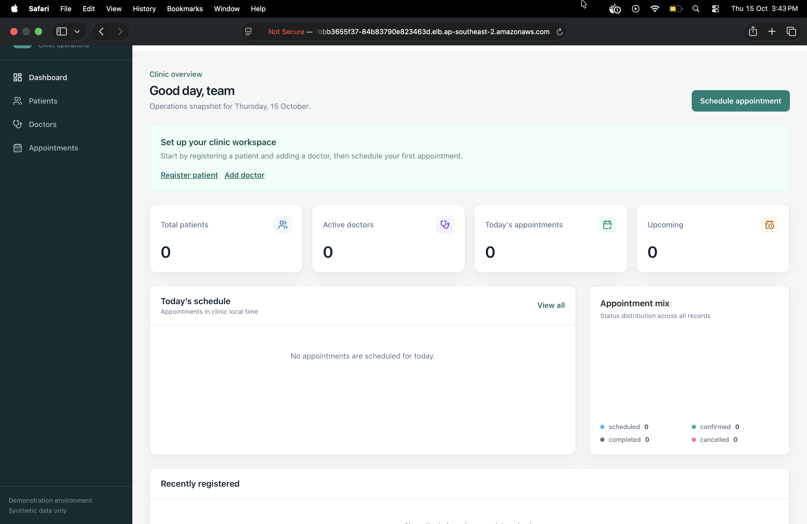
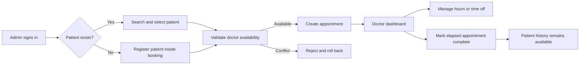
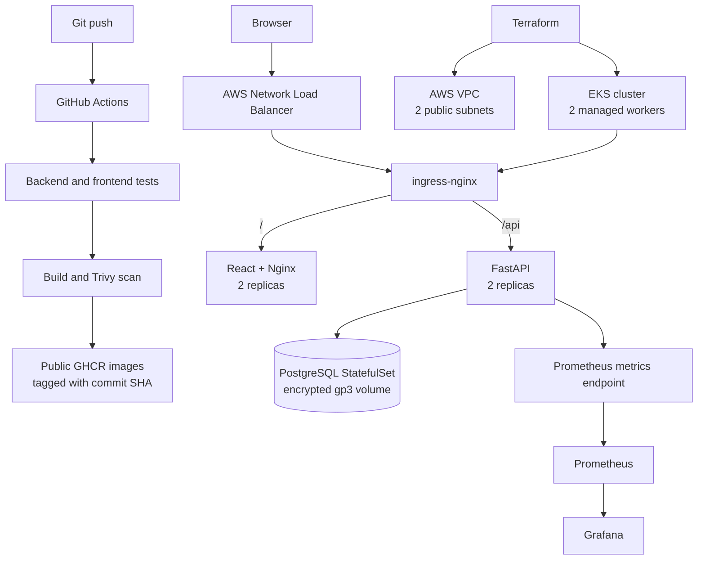

# CareFlow

CareFlow is a full-stack clinic operations application and DevOps capstone. It gives administrators one place to manage patients, doctors, and appointments, while each doctor receives a private dashboard for their schedule and availability.

[Repository](https://github.com/Siddhesh224-ai/careflow-devops-capstone) · [CI pipeline](https://github.com/Siddhesh224-ai/careflow-devops-capstone/actions/workflows/ci.yml) · [Backend image](https://github.com/users/Siddhesh224-ai/packages/container/package/careflow-backend) · [Frontend image](https://github.com/users/Siddhesh224-ai/packages/container/package/careflow-frontend)

> **Demonstration software only.** Use synthetic data. CareFlow has not been audited for healthcare compliance and must not hold real patient information.



## What the application does

| Role | Capabilities |
| --- | --- |
| Administrator | Sign in, view clinic totals, search or register patients, review patient appointment history, create doctors and their logins, and schedule or manage appointments. |
| Doctor | Sign in to a separate dashboard, view only their appointments, set weekly working hours, block specific time off, and mark elapsed appointments complete. |

An appointment can be scheduled for an existing patient or together with a new patient. The combined operation is atomic: if scheduling fails, the new patient is rolled back. A booking is accepted only when the doctor is active, working at that time, not on time off, and has no overlapping active appointment.



Authentication uses signed JWT bearer tokens with a 48-hour lifetime. Tokens are stored in tab-scoped `sessionStorage`, so an administrator and a doctor can remain signed in independently in different browser tabs.

## Architecture



The backend is a modular monolith with `route -> service -> repository -> SQLAlchemy model` separation. Services own validation and transaction boundaries; Alembic owns schema changes. Concurrent booking is protected by a per-doctor PostgreSQL advisory lock plus a partial GiST exclusion constraint, so overlapping active appointments are rejected even under concurrent requests.

### Technology stack

| Layer | Technology |
| --- | --- |
| Frontend | React, TypeScript, Vite, TanStack Query, Nginx |
| Backend | FastAPI, Pydantic, SQLAlchemy, Alembic, PyJWT, Argon2 |
| Data | PostgreSQL 16 |
| Local platform | Docker, Docker Compose, pgAdmin (optional profile) |
| CI and security | GitHub Actions, Buildx, Trivy, GHCR |
| Cloud platform | AWS VPC, EKS, EBS CSI, Network Load Balancer |
| Deployment | Kubernetes, Helm, ingress-nginx |
| Observability | Prometheus, ServiceMonitor, Grafana |

## Repository map

```text
backend/                 FastAPI source, Alembic migrations, and Pytest suite
frontend/                React application and frontend tests
docker-compose.yml       Local PostgreSQL, migrations, bootstrap, API, and UI
.github/workflows/       Test, build, scan, and publish pipeline
terraform/               AWS VPC, EKS, worker nodes, and EBS CSI identity
k8s/                     CareFlow namespace
helm/careflow/           Application, PostgreSQL, jobs, ingress, and monitoring
monitoring/              kube-prometheus-stack values
evidence/                Reviewed, non-secret assessment evidence
PROJECT_REQUIREMENTS.md  Source grading rubric
```

## Run locally

Prerequisites: Docker Desktop with Compose and Git. Docker is the shortest supported path; a host Python virtual environment does not need to be activated inside a container.

```bash
git clone https://github.com/Siddhesh224-ai/careflow-devops-capstone.git
cd careflow-devops-capstone
cp .env.example .env
```

Replace every placeholder in `.env`, then start the complete stack:

```bash
docker compose up --build -d
docker compose ps
```

- Application: <http://localhost:3000>
- API documentation: <http://localhost:8000/docs>
- API health: <http://localhost:8000/health>

The one-shot `migrate` container applies Alembic migrations and `bootstrap` creates or updates the single administrator before the API starts. The database persists in the `postgres_data` volume.

```bash
# Run the backend suite against the dedicated careflow_test database
docker compose --profile test run --build --rm test

# Stop the stack but preserve database data
docker compose down

# Destructive: also delete local database and pgAdmin volumes
docker compose down --volumes
```

Optional pgAdmin is available at <http://localhost:5050> after `docker compose --profile tools up -d pgadmin`. Connect to host `db`, port `5432`, using the database values from `.env`.

## Delivery pipeline

Every push to `main` follows the same immutable-image path:

1. Run the PostgreSQL-backed Pytest suite and fail if any test is skipped.
2. Run frontend tests and the TypeScript/Vite production build.
3. Build the backend and frontend container images.
4. Scan both images with Trivy for `HIGH` and `CRITICAL` fixable vulnerabilities.
5. Push successful images to GHCR using the full Git commit SHA as the tag.
6. Deploy that exact SHA with Helm; no mutable `latest` tag is used.

Trivy scans the final images, including application packages and operating-system packages. Fixable `HIGH` or `CRITICAL` findings fail the job and prevent publication. `ignore-unfixed` is temporarily enabled only for vendor-unfixed Debian base-image findings; the rationale and review date are recorded in [SECURITY.md](SECURITY.md).

## AWS and Kubernetes deployment

Terraform provisions the Sydney deployment in `ap-southeast-2`: one VPC, two public subnets in separate availability zones, an EKS control plane, two managed worker nodes, and EKS Pod Identity for the EBS CSI driver. Helm installs CareFlow in the `careflow` namespace with:

- two backend and two frontend replicas;
- ClusterIP services and hostless `/` and `/api` ingress routes;
- ordered migration and administrator-bootstrap hook Jobs;
- a demonstration PostgreSQL StatefulSet with a 5 Gi encrypted `gp3` volume;
- health probes, resource requests/limits, rolling updates, and a ServiceMonitor.

Secrets are created interactively as the `careflow-secrets` Kubernetes Secret and are never stored in Helm values or Git.

<details>
<summary>Deployment, verification, rollback, and teardown commands</summary>

```bash
# Configure access
aws login --profile careflow-admin --region ap-southeast-2
aws eks update-kubeconfig --region ap-southeast-2 --name careflow-eks --profile careflow-admin

# Deploy the reviewed chart values
kubectl apply -f k8s/namespace.yaml
helm upgrade --install careflow helm/careflow --namespace careflow --timeout 15m

# Verify
kubectl get pods,svc,ingress -n careflow
helm list -n careflow

# Roll back one Helm revision if required
helm history careflow -n careflow
helm rollback careflow <REVISION> -n careflow --wait --timeout 15m
```

Final teardown must remove Kubernetes-created load balancers and volumes before Terraform:

```bash
helm uninstall careflow -n careflow
helm uninstall monitoring -n monitoring
helm uninstall ingress-nginx -n ingress-nginx
kubectl get svc -A --field-selector spec.type=LoadBalancer

cd terraform
terraform plan -destroy -out=careflow-destroy.tfplan
terraform apply careflow-destroy.tfplan
```

`terraform apply` and `terraform destroy` create and remove billable resources. Confirm the AWS identity, profile, region, and plan before approval, and verify EKS, EC2, load balancers, EBS volumes, and the VPC are gone afterward.

</details>

### Infrastructure decisions and compromises

- The original target was two `t3.medium` workers. This AWS Free Plan account rejected that type, so the demonstrated cluster used two `m7i-flex.large` workers that were eligible for the account and fit its five-vCPU quota. This preserves the two-worker architecture but does not satisfy a requirement for the literal `t3.medium` type.
- An organization service-control policy denied `iam:CreateOpenIDConnectProvider`. IRSA was therefore disabled and the EBS CSI controller received a dedicated role through EKS Pod Identity instead of broadening the worker-node role.
- In-cluster PostgreSQL is appropriate for this short-lived demonstration, not a production healthcare deployment. A production design should use a managed, private, backed-up database such as Amazon RDS.

## Requirements and evidence

This matrix maps the implementation directly to [PROJECT_REQUIREMENTS.md](PROJECT_REQUIREMENTS.md) without making the reader inspect every screenshot.

| Module | What was delivered | Evidence |
| --- | --- | --- |
| **M1 — Application** | FastAPI health/readiness and REST APIs; React UI; PostgreSQL models and Alembic migrations; admin and doctor workflows. | [Ingress application](evidence/screenshots/application_ingress.png), [`backend/app`](backend/app), [`frontend/src`](frontend/src) |
| **M2 — Testing** | PostgreSQL test database guard, fixtures, and 14 currently defined tests across health/metrics, auth, patients, doctors, appointments, dashboard, and doctor portal. | [13-pass captured run](evidence/screenshots/backend_tests_passed.png), [`backend/tests`](backend/tests), [`pytest.ini`](backend/pytest.ini) |
| **M3 — Git/GitHub** | Public repository, ignored secrets/build output/state, and 14 meaningful commits at the time of this README. | [Commit history](https://github.com/Siddhesh224-ai/careflow-devops-capstone/commits/main/), [`.gitignore`](.gitignore) |
| **M4 — Docker** | Non-root backend image, multi-stage non-root frontend image, and a health-ordered Compose stack for PostgreSQL, migrations, bootstrap, API, and UI. | [Healthy Compose services](evidence/screenshots/docker_containers_healthy.png), [`docker-compose.yml`](docker-compose.yml), [backend Dockerfile](backend/Dockerfile), [frontend Dockerfile](frontend/Dockerfile) |
| **M5 — CI/CD** | Push/PR pipeline; backend and frontend gates; two SHA-tagged public GHCR images. | [Successful workflow](evidence/screenshots/github_actions_success.png), [backend package capture](evidence/screenshots/github_backend_package.png), [public frontend package](https://github.com/users/Siddhesh224-ai/packages/container/package/careflow-frontend), [`ci.yml`](.github/workflows/ci.yml) |
| **M6 — DevSecOps** | Trivy scans both final images and fails on fixable `HIGH`/`CRITICAL` findings before push. | [Passed build/scan/push steps](evidence/screenshots/successfull_gh_run_watch.png), [security decision](SECURITY.md) |
| **M7 — Terraform** | Valid pinned modules; VPC and two public subnets; EKS with two managed workers; EBS CSI Pod Identity; 53 Terraform-managed resources destroyed after evaluation. | [Saved plan](evidence/screenshots/terraform_plan_created.png), [successful apply](evidence/screenshots/terraform_apply_complete.png), [redacted VPC resource map](evidence/screenshots/aws_vpc_resource_map_redacted.png), [two Ready nodes](evidence/screenshots/aws_nodes_ready.png), [EBS CSI active](evidence/screenshots/ebs_csi_active.png), [destroy complete](evidence/screenshots/terraform_destroy_complete.png) |
| **M8 — Kubernetes/Helm** | Namespace, complete Helm chart, two application replicas per tier, services, ingress, hooks, StatefulSet, probes, limits, and rolling updates. | [Pods](evidence/screenshots/kubectl_get_pods.png), [services](evidence/screenshots/kubectl_get_svc.png), [Helm release](evidence/screenshots/helm_list.png), [Ingress application](evidence/screenshots/application_ingress.png) |
| **M9 — Observability** | FastAPI Prometheus instrumentation, ServiceMonitor discovery, kube-prometheus-stack, two healthy scrape targets, and a live request-rate panel. | [`/metrics` output](evidence/localhost/metric_output.txt), [Prometheus target UP](evidence/screenshots/prometheus_backend_up.png), [Grafana panel](evidence/screenshots/grafana_request_rate.png) |
| **M10 — Documentation/demo** | This architecture and operations guide plus a visible UI-change commit and recorded deployment workflow. | [Recorded walkthrough](demo/demo_video.mov), [demo commit](https://github.com/Siddhesh224-ai/careflow-devops-capstone/commit/c44f646b646535437bf13bfbc5805bffd25821cd) |

> **Evidence note:** All AWS infrastructure shown in these captures was subsequently destroyed by Terraform. Any visible VPC, subnet, node, endpoint, or add-on values are historical resource identifiers—not credentials or active secrets. The VPC resource-map capture is redacted to minimize account-identifying information.

## Live-change demonstration

The demonstration change updates the sidebar subtitle in `frontend/src/components/layout/AppShell.tsx` from **“Clinic operations”** to **“CareFlow Clinic operations”**. It was committed as `c44f646` so the change is small, visible, and easy to trace through the full pipeline.

The recorded walkthrough follows this sequence:

1. Show the original deployed text and the source line.
2. Make the frontend text change, review `git diff`, commit, and push to `main`.
3. Watch backend tests, frontend tests/build, both Trivy scans, and both GHCR pushes succeed.
4. Copy the new full commit SHA used as the image tag.
5. Upgrade the Helm release to that SHA and watch the frontend rollout complete.
6. Refresh the ingress URL and show the changed text in the deployed application.
7. Show the Prometheus target and Grafana request-rate panel, then retain teardown for the end of evaluation.

> **Recorded walkthrough:** [watch or download the submitted demonstration](demo/demo_video.mov).

## Current limitations

- No refresh tokens, password reset, login rate limiting, audit trail, backup automation, TLS/domain setup, or healthcare compliance controls.
- Single-clinic demonstration; no tenancy, billing, prescriptions, reminders, or medical-record system.
- The hostless ingress uses HTTP for the temporary demonstration endpoint.
- The in-cluster PostgreSQL deployment is intentionally single-replica and demonstration-only.
